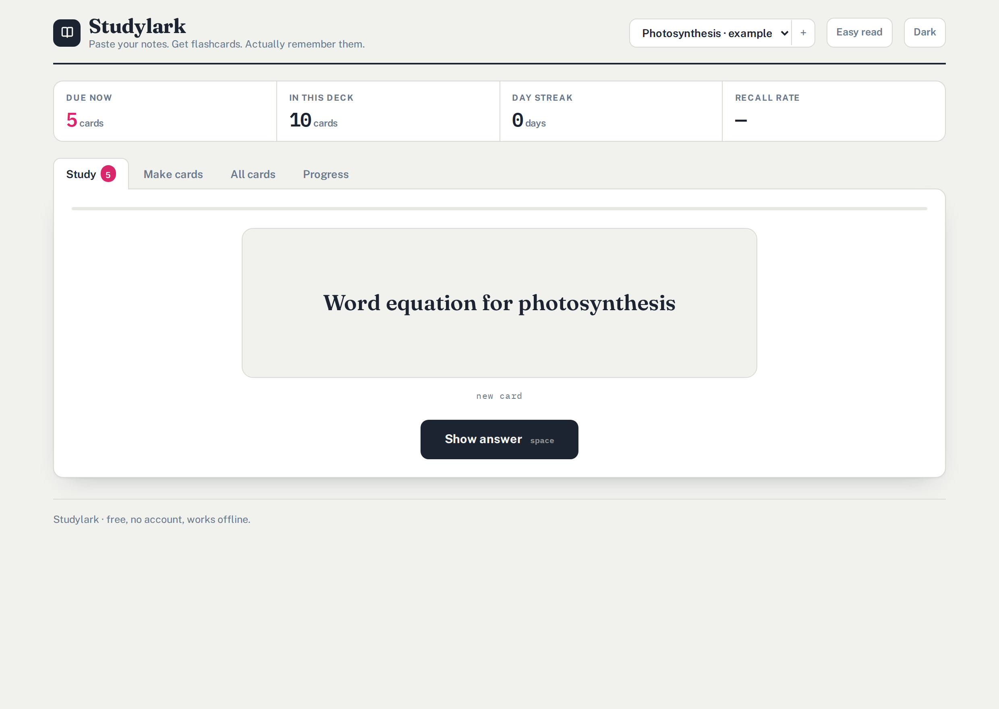

# Three products

| | What it is | Money model |
|---|---|---|
| **[Studylark](#studylark)** (this folder, served at `/`) | Paste notes → flashcards → spaced repetition | Free; tips and paid deck packs — see [MONETIZATION.md](MONETIZATION.md) |
| **[Toolsmith](toolsmith/)** (served at `/toolsmith/`) | Six creative tools replacing the Adobe apps people use daily | Paid: £9 once — see [toolsmith/SELLING-IT.md](toolsmith/SELLING-IT.md) |
| **[Hearth](hearth/)** (served at `/hearth/`) | AI chat that runs models on your own machine, plus a live list of which models are genuinely free | Free; costs nothing to run |

All three run in the browser with no server and no account. Studylark and
Toolsmith make no third-party requests at all and work offline; Hearth needs the
network for hosted models, but a local model runs with the wifi off.

---

# Studylark

**Paste your notes. Get flashcards. Actually remember them.**

Studylark reads a page of notes and writes the flashcards for you, then drills
you on them using spaced repetition — the scheduling method that puts a card in
front of you right before you'd forget it, so things stick for months instead of
until Friday's test.

It is one HTML file. There is no server, no account, and no sign-up. Your notes
never leave your browser, because there is nowhere for them to go.



---

## Why it exists

Every other flashcard app makes *you* type the cards. That's the boring part, so
most people quit before the useful part starts. Studylark does that bit for you.

| | Studylark | Quizlet | Anki |
|---|---|---|---|
| Makes cards from your notes | yes | no | no |
| Free with no paywalled modes | yes | no | yes |
| Works with no account | yes | no | yes |
| Works offline | yes | partly | yes |
| Runs on a locked-down school laptop | yes | often blocked | needs install |

## What it does

- **Turn notes into cards.** Paste notes, press one button. It recognises
  `Term: definition`, `Term - definition`, a question ending in `?` with the
  answer underneath, `X is Y` sentences, and `**bold**` words. Anything left over
  becomes a fill-in-the-blank. You review every suggestion before it's added —
  the parser is decent, but you know your subject better than it does.
- **Study with real spaced repetition.** An SM-2 scheduler with learning steps.
  Each grade button shows exactly when you'll see that card again, so nothing is
  mysterious.
- **See what's coming.** A seven-day forecast of your review load.
- **Share a deck with a link.** The entire deck is compressed *into the URL*.
  Send it to a friend and it opens straight into their Studylark. No upload.
- **Easy read mode** for anyone who finds tight text hard going, plus full
  keyboard control (`space` to reveal, `1`–`4` to grade) and dark mode.
- **Back up to a file** whenever you want. Your cards are yours.

## Running it

It's a static site — no build step, no dependencies to install.

```sh
git clone https://github.com/kleepznoob/i-really-wanna-impress-me-parents-by-making-money.git
cd i-really-wanna-impress-me-parents-by-making-money
npx http-server -p 8080     # or: python3 -m http.server 8080
```

Then open <http://localhost:8080>. Use a server rather than opening the file
directly — service workers and the offline cache need `http://` or `https://`.

## Putting it online

The repo is ready for GitHub Pages. In the repository settings go to
**Settings → Pages → Source → GitHub Actions**. The workflow in
`.github/workflows/pages.yml` publishes on every push to the branch.

## How it's built

| File | What it is |
|---|---|
| `index.html` | The whole app — markup, styles, and logic in one file |
| `fonts/` | Self-hosted Fraunces, Public Sans and IBM Plex Mono |
| `vendor/lz-string.min.js` | Compresses a deck small enough to fit in a URL |
| `sw.js` | Service worker; caches the app so it works offline |
| `manifest.webmanifest` | Lets phones install it to the home screen |

**No third-party requests.** The fonts are self-hosted and the one library is
vendored, so after the first load Studylark talks to nothing. That isn't just
tidy — an app that promises "your notes stay on your device" shouldn't be
quietly telling a font CDN who's studying at 2am.

Data lives in `localStorage` under `studylark.v1`. Every read and write is
wrapped in `try`/`catch`, so the app still works in a private window where
storage is blocked — you just don't keep progress between visits. That's what
the backup file is for.

### The scheduler

New and lapsed cards go through learning steps (1 min, 10 min). Graduating sets
a one-day interval. After that each successful review multiplies the interval by
the card's ease factor, which starts at 2.5 and moves with your answers:

| You press | What happens |
|---|---|
| Forgot | ease −0.20, interval cut to 40%, back to learning |
| Hard | ease −0.15, interval × 1.2 |
| Got it | interval × ease |
| Easy | ease +0.15, interval × ease × 1.25 |

Ease is clamped to 1.3–3.2 and intervals cap at five years.

## Licence

MIT — see [LICENSE](LICENSE). Use it, fork it, sell it.

## Money

See [MONETIZATION.md](MONETIZATION.md) for the plan, including the parts that
legally need a parent.
