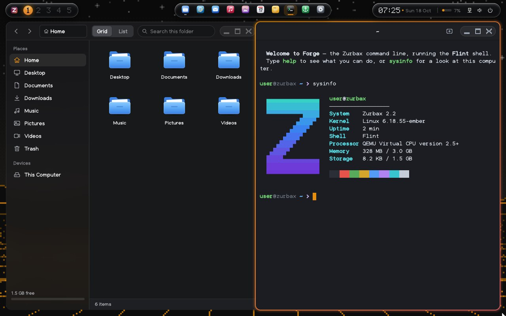
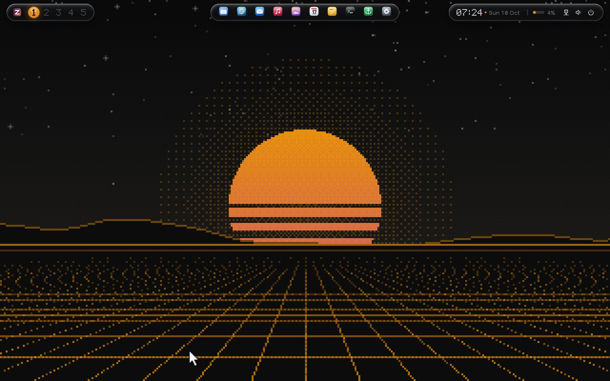
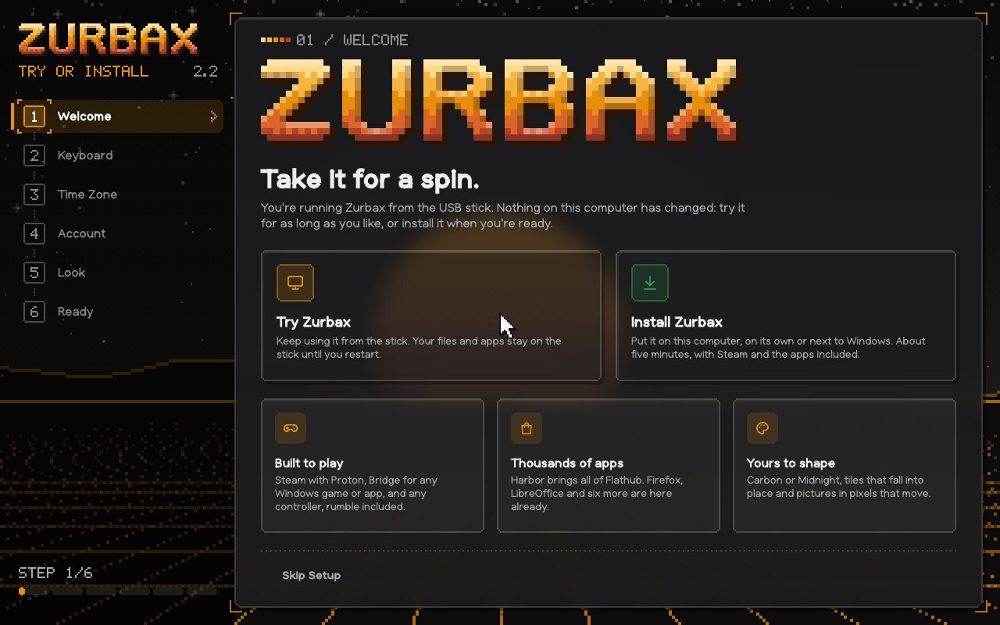
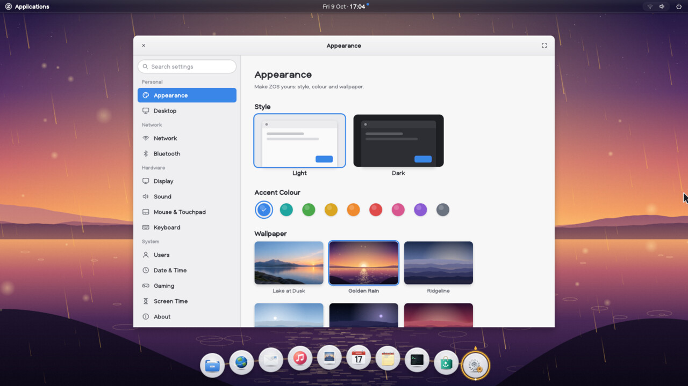
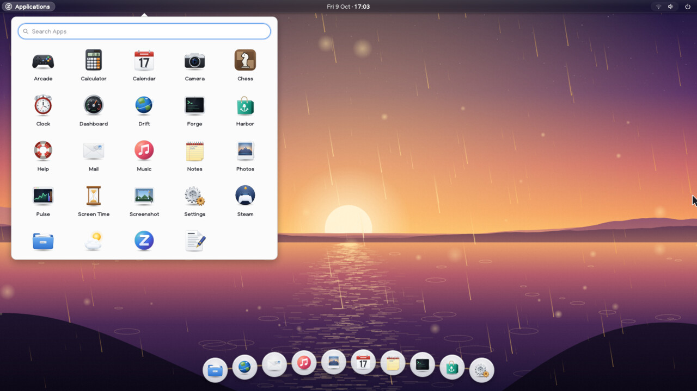
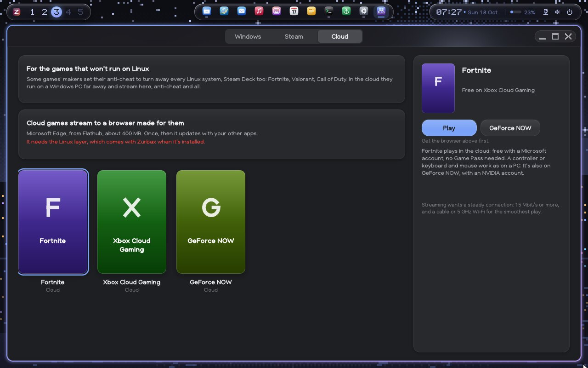
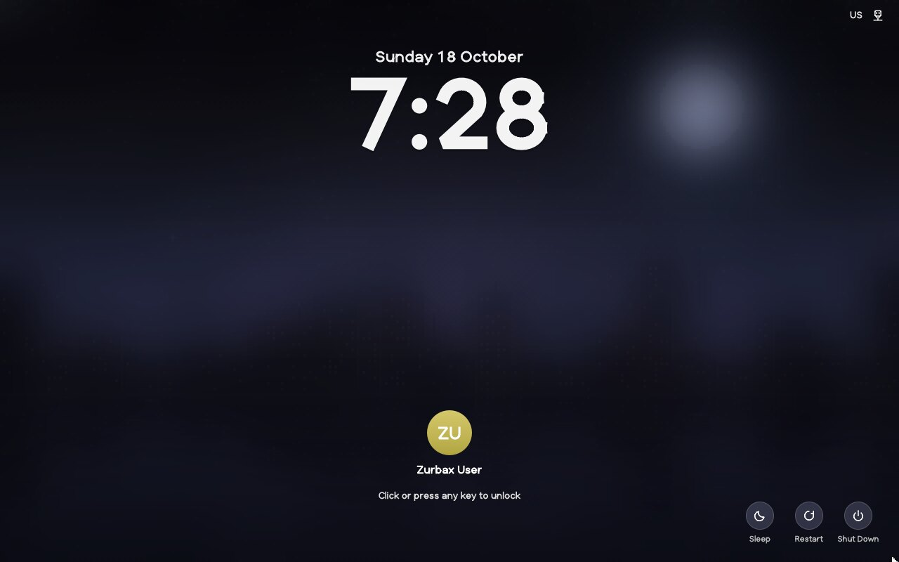

# Zurbax

Zurbax is a desktop operating system for PCs, built on Linux.

The kernel is Linux. Zurbax's build of it is called Ember: Linux 6.18 from
the long-term branch, with a few patches of its own. Everything you see on
top of it is Zurbax's own code, written in C: the desktop and window
system, the graphics and the font, the toolkit, every app, the init
system, the network and sound, the installer and the updates. None of that
part uses glibc, GTK, Qt or an X server.

Programs from the wider Linux world run too, in what Zurbax calls the
Linux layer: a separate image with glibc, Mesa, Xwayland and the rest of a
standard Linux userland. Steam and Proton, Flathub's apps (Firefox,
LibreOffice and thousands more) and a full GNOME desktop run there, side by
side with Zurbax's own apps. Windows programs run through Proton with
Bridge.



Zurbax 2.2 starts on **Hive**, a tiling desktop of liquid glass: windows
share the screen side by side, and everything is a keystroke away. It
comes in two themes, Carbon (black and orange) and Midnight (deep blue),
each with a pixel-art wallpaper that moves. If you'd rather drag windows
around, the Classic desktop with a taskbar is one click away in Settings.

(Inside the source, programs, paths and settings carry the name in lower
case, `zurbax`.)

## Download

From **[zurbax.com](https://www.zurbax.com)**, which keeps the files on the
[Internet Archive](https://archive.org/details/zurbax-2.2):

| Image | Size | What's on it |
|---|---|---|
| [`zurbax.iso`](https://www.zurbax.com/download/2.2/zurbax.iso) | 7.1 GB | Everything: the system, every driver and firmware file, Steam and Proton, GNOME and the ready apps. Installs without the internet. |
| [`zurbax-standard.iso`](https://www.zurbax.com/download/2.2/zurbax-standard.iso) | 3.5 GB | The same without the second and third groups of ready apps (they're a click away in Harbor). Fits a 4 GB stick. |
| [`zurbax-mini.iso`](https://www.zurbax.com/download/2.2/zurbax-mini.iso) | 140 MB | The system alone. The installer downloads the rest. |

[`SHA256SUMS`](https://www.zurbax.com/download/2.2/SHA256SUMS) has the
checksums. The images are hybrids: write one to a USB stick with
balenaEtcher, Rufus, Ventoy or `dd`, or burn it to a DVD. Start the PC from
it in UEFI mode (on ASUS PCs, press Esc or F8 for the boot menu), try
Zurbax from the stick, and install it from there if you like it, on its own
or next to Windows.

## Screenshots

| | |
|---|---|
|  **Hive**: the Carbon theme, and its sunset that moves |  **Setup**: try Zurbax from the stick, or install it |
|  **Settings**: the desktop, its theme and wallpaper |  **Launcher**: every app, a few keys away |
|  **Bridge**: Windows programs through Proton, and cloud games in the Midnight theme |  **Lock screen**: the date over a large clock |

## What works and what doesn't

- **Graphics:** AMD and Intel fully. NVIDIA's own driver (595) for GeForce
  RTX 20, 30, 40 and 50 and GTX 16, on the images that carry it (full and
  standard); older GeForces, and the mini image, get nouveau, the open
  driver.
- **Games:** Steam with Proton runs most Windows games. Games whose
  anti-cheat turns Linux away on purpose (Fortnite, Valorant, most Call of
  Duty) don't; Bridge's Cloud tab streams them from Xbox Cloud Gaming or
  GeForce NOW instead.
- **Wi-Fi:** WPA2-Personal and open networks. WPA3-only and enterprise
  networks don't work yet.
- **Drift**, Zurbax's own browser, doesn't run JavaScript. Firefox from
  Flathub is there for the sites that need it.

## What it does

**Boot.** The firmware's own logo (the ASUS logo on an ASUS PC) stays on
screen from power-on to the desktop, with a spinner under it, and not one
line of text: the kernel is built without a text console, its boot code
and early console are silent, and its log level lets nothing through. The
kernel has the whole system inside it, and the firmware starts it
directly, with no boot loader in between.

**Classic desktop.** Picked in Settings → Appearance. The top bar shows the app in front (click it for New Window,
Minimize, Maximize, Show Desktop and Quit), the date and time (the
calendar and your notifications) and the status icons (quick settings:
Wi-Fi networks, dark style, night light, Do Not Disturb, sound,
brightness and power). The taskbar has Start, a search box, and a button
for each pinned or running app: a line under it marks an open app (in the
accent colour for the one in front), a badge counts its unread
notifications, hovering shows live previews of its windows (click one to
switch, or close it from there), middle-click opens a new window and
right-click pins, unpins or closes. At the right are notifications and a
show-desktop strip. Settings → Desktop changes it all: the taskbar's size
(small, medium, large), centred or left-aligned buttons, app names beside
the icons, the search box, previews, auto-hide, a light taskbar in the
light style, and turning the top bar off (the clock and status icons then
move into the taskbar's tray). The launcher (Start, the search box, or a
tap of the Super key) fills the screen: the apps you open most, the
categories, and every app A to Z. Typing searches apps, Settings pages and
power actions, works out sums (Enter copies the answer), and offers to
search the web in Drift or Flathub's apps in Harbor. The lock screen shows
the wallpaper, the date over a large clock, waiting notifications, and you
with a password field. Plus notification sounds and screenshots (Print
Screen).

**Hive.** The desktop Zurbax starts on: a tiling one made of liquid
glass. Windows share the screen side by side (each new one
splits the window in focus), with airy gaps between; every window is a
rounded pane with a rim of light, and the one in focus wears a ring of the
theme's two accents and a soft glow that passes from window to window
with the focus. The bar floats as three islands of glass (the
workspaces, where a bead of the accent flows from one to the next; the
clock; the status), and the launcher, the keys and the power menu are
panes of glass. Nine workspaces slide across. Everything is a keystroke
away (Super+Return a terminal, Super+Space the launcher, Super+W closes,
Super+Z zooms a window, Super+V floats it, Super+1…9 workspaces), and
Super+K shows every key as keycaps. Two themes, Carbon (black and
orange, the default) and Midnight (deep blue and violet), Super+Ctrl+Space
to switch, colour the rings, the glass and the apps, and each brings its
own pixel-art wallpaper painted on the spot with dithered gradients: a sun
going down striped over a grid, and a city by a river at night. The
wallpapers move: stars twinkle and shoot, lines run down the grid, the
water glitters.

**Glass.** Apps' sidebars (Settings, Files, Music, Mail, Notes, Calendar,
Photos) are frosted glass the wallpaper shows through, as are the
shell's bars and panels; "Transparency effects" in Settings turns it off.

Game mode, an FPS counter and keyboard layouts (US, UK, Romanian, German,
French, Spanish) are built in. The Classic desktop's wallpapers: Silk (its default: folds of
warm coral and amber light drifting across deep aubergine, the same
picture in GNOME), Horizon (soft hills under a sky going from ink to iris
to the first gold of the day) and Daybreak, its pale morning, Golden Rain,
the Lake at Dusk photo and five painted landscapes, all drawn to fit any
screen.

**Game controllers.** Xbox, PlayStation, Switch Pro, Steam and other USB
controllers work the moment they're plugged in, up to four at once. The
Guide button opens Apps, and the D-pad, A and B move around it. Every app can be used with a controller: the D-pad and left
stick act as the arrow keys, A as Enter and B as Escape. Games can make
controllers vibrate, the top bar shows when one is connected, and a notice
gives its battery level. The Arcade's games have proper controller
layouts, and Settings → Gaming shows a live picture of each controller to
test its buttons, sticks and vibration. F11 makes any window full screen,
which also turns on game mode.

**Linux programs.** zdisplay also speaks Wayland, the window protocol
standard Linux programs use (its own implementation of it, not libwayland's).
Wayland programs, and X11 programs through Xwayland, open as ordinary Zurbax
windows: they move, resize, maximize, go full screen, show their menus and
cursors and sit in the taskbar like Zurbax apps, and they type with the keyboard
layout chosen in Settings. Games can lock the pointer and read raw mouse
motion for mouse-look. A full-screen game that keeps a smaller picture is
shown centred at its own aspect ratio. Programs that draw with the GPU share
their buffers with zdisplay (linux-dmabuf), and a full-screen game alone on
screen goes straight to the display from its own buffer, with no copy.

**Steam.** The Steam app starts Valve's Steam client, and through it Proton
for Windows games, full screen in Big Picture or as a desktop window. Steam
is a standard Linux program, so it runs from the Linux layer, a separate
root file system built from upstream sources by `layer/build.sh`: glibc
2.42 and GCC 15.2's runtime (64- and 32-bit), Mesa 26.2 with AMD's
(radeonsi, RADV) and Intel's (iris, crocus, ANV, HASVK) OpenGL and Vulkan
drivers plus zink, virgl and softpipe, libglvnd, the Vulkan loader, X11's
libraries, Xwayland, PulseAudio playing through Zurbax's sound service, fonts,
a GNU userland and Valve's launcher. It ships as one compressed image
(`steam.sfs`) on the install stick and ISO; zinit mounts it at
`/data/layers/steam`, from the stick in a live session and from the disk
once installed (the installer copies it). `layerrun` starts programs inside
the layer through a user namespace, with no privileges, along with a
full-screen Xwayland, `zos-xwm` (a window manager for that screen: full
screen for games and Big Picture, focus, centred dialogs), a D-Bus session
bus and the sound server. The Steam app checks that everything is in place
and names the GPU games will use. Valve's client starts from the layer,
updates itself, builds its runtime container inside layerrun's namespace,
and shows Big Picture full screen on Zurbax's display, taking clicks and
typing.

**Graphics drivers.** The kernel carries AMD's, Intel's and NVIDIA's GPU
drivers with the firmware they start with (Radeon RX 400 series and newer,
Ryzen graphics, Steam Deck; Intel 6th generation and newer, Arc; GeForce
RTX 20 and newer through NVIDIA's own driver, older GeForces through
nouveau with Mesa's NVK for Vulkan), so screens run
at their native resolution and refresh rate and GPUs save power; machines
without one of these use the firmware's framebuffer.

**Every driver.** Ember, Zurbax's kernel, builds in what starting needs
(disks, screens, keyboards, touchpads, Ethernet and Wi-Fi), and every other
driver a PC or laptop can have, about 5,000 of them, as modules in
`drivers.sfs`, an image beside the system like the firmware's. Each module
is signed with a key made for the build and thrown away, and the kernel
loads no other. Zurbax's own loader (`system/modprobe`) picks them: at
startup for every device there is, as devices are plugged in, and when the
kernel asks for one (a file system, a network protocol). The list comes
from a general-purpose distribution's (`tools/gen-modules-config.py`),
without what PCs don't have: data-centre cards, industrial sensors, phone
and board chips.

**First start.** The Welcome assistant covers keyboard, time zone, an
account and a look. Every step can be skipped. When started from the USB
stick, it offers to try Zurbax or install it.

**Installing.** The Installer either erases a disk or installs into its
free space next to Windows, and adds a "Zurbax" entry to the firmware's
boot menu. It takes about a minute.

**Apps**

| App | What it is |
|-----|------------|
| Drift | Web browser with its own HTML and CSS engine: tabs, bookmarks, history, search, forms, find, zoom |
| Harbor | App store: install, update and remove apps from the built-in source, signed web sources and Flathub (Linux apps, through Flatpak) |
| Mail | Email for Gmail, Outlook, iCloud, Yahoo or any IMAP account: HTML mail, attachments, search, drafts, undo |
| Dashboard | Your day at a glance: weather, calendar, recent files, screen time |
| Camera | Photos from the webcam, with looks and a timer |
| Help | A searchable guide to Zurbax, with what's new |
| Arcade | Glide, a 3D flying game, plus Blocks, Snake, 2048, Mines and Breakout, with best scores; keyboard, mouse or controller |
| Music | Albums, songs and artists from your Music folder (FLAC, Ogg Vorbis, WAV) |
| Weather | Live forecasts with an hourly strip, the week and details |
| Photos | Viewer for PNG, JPEG, GIF and BMP |
| Vault | Files, with thumbnails |
| Forge | Terminal running the Flint shell, with `sudo` |
| Writer | Text editor |
| Notes, Calendar, Clock, Calculator | The everyday tools |
| Screen Time | Daily app usage, limits, break reminders and downtime |
| Pulse | System monitor |
| Screenshot | Capture the screen, a window or an area |
| Settings | Appearance, wallpaper, display, sound, network, keyboard, mouse, power, users, about |
| Welcome, Installer | Setup and installation |

**Glide** is the Arcade's 3D game: fly a paper glider through golden rings
over an endless low-poly land of lakes, hills and forests at sunset. It's
drawn by Zurbax's own 3D renderer on every processor core, and lowers its
resolution by itself when a machine can't keep up.

**In Harbor** (installed when you want them): Chess, with a computer
opponent from Easy to Expert; Sudoku, with fresh puzzles that each have one
solution; and Paint, for sketching and marking up pictures.

**Mail** blocks pictures from the web until you ask for them, since loading
them tells the sender you opened the message. It shows HTML mail with
Drift's engine but never runs scripts or loads outside style sheets. It
won't send your password over a connection that isn't encrypted. Gmail
needs an app password (Mail explains how when you type a Gmail address).
`tools/mailtest.py` runs a pretend mail server for trying it out.

**Under the hood**
- **TLS 1.3** with certificate checks against Mozilla's root list.
- **HTTP** downloads, and the `fetch` command.
- **Wi-Fi** with WPA2-Personal and open networks: znet runs the WPA2
  handshake itself over the kernel's nl80211 interface, and images carry the
  firmware for common Intel, MediaTek and Realtek laptop chips.
- **DHCP networking** on wired and wireless connections.
- **A sound mixer** that drives the sound card directly.

## Building

```sh
make            # everything: libraries, system programs, apps
make test       # the test suites (runtime, graphics, 3D, toolkit, TLS/crypto, audio, Wi-Fi, disks)
make image      # the kernel with the system inside, build/zurbax.iso and build/zurbax.img
make run        # boot build/zurbax.img in QEMU with UEFI firmware
layer/build.sh  # the Linux layer for Steam (hours), build/layer/steam.sfs
```

A C compiler and `make` are enough for the system itself. Building the
kernel also needs the usual kernel build tools (`bc`, `flex`, `bison`,
`libelf`, `libssl` headers). `kernel/build.sh` downloads Linux on first use,
and `make image` fetches the Wi-Fi and GPU firmware from linux-firmware.
`make image` puts `build/layer/steam.sfs` on the stick and ISO when it has
been built. The layer's build compiles its own GCC first and everything
else with it, as cross builds against the layer; it needs the tools listed
in the `layer` job of `.github/workflows/build.yml` (LLVM 18 and Clang for
Mesa's OpenCL compiler, meson, cmake, autotools, mksquashfs) and about
10 GB of space. Its sources are pinned with their SHA-256 sums in
`layer/sources.txt`.

To try it on a real PC, burn `build/zurbax.iso` to a DVD, or write it to a
USB stick with balenaEtcher, Rufus or `dd`, and boot from it in UEFI mode.
On ASUS machines, press F8 or Esc for the boot menu. The ISO is a hybrid:
a UEFI El Torito image for discs, and a GPT for USB sticks, sharing one
copy of the kernel. `build/zurbax.img` is a plain USB stick image. GitHub
Actions builds both on every push (see the `zos-2.0-golden-rain` artifact),
and publishes them as a release when the `build` workflow is started by
hand with a tag name (for example `v2.0.0`). The Installer finds the system
on whichever one Zurbax started from.

## Layout

| Path | What it is |
|------|------------|
| `libzr/` | The runtime: syscalls, memory, strings, files, time zones, processes, events, JSON, SHA-256 |
| `libzg/` | Graphics: rasterizer, gradients, blur, PNG/JPEG/GIF/BMP, SVG icons, the font, a software 3D renderer |
| `libzui/` | The toolkit: widgets, layout, text editing, dialogs, sound client |
| `libzn/` | Networking: crypto, X.509, TLS 1.3, DNS, HTTP |
| `libza/` | Audio files: WAV, FLAC, Ogg Vorbis, tags and cover art |
| `libzd/` | Disks: GPT, FAT32, ext4, ISO 9660 with El Torito, cpio |
| `system/` | zinit (process 1), zdisplay (display server and desktop), znet, zaudio, zinstall, modprobe, harborctl, layerrun, the Flint shell, sudo, fetch, play |
| `apps/` | The apps |
| `store/` | Apps offered in Harbor, packaged by `mkimage repo` |
| `kernel/` | Ember: its patches, configuration (built in, and modules), build script and the list of GPU firmware |
| `layer/` | The Linux layer for Steam: upstream sources (pinned) and how to build them |
| `tools/` | Image builder, QEMU test drivers (with a simulated access point and a virtual controller), the Wayland protocol table generator (`wlgen.py`), development helpers |
| `data/` | Icons, wallpaper, trusted root certificates, Harbor's trusted keys |
| `tests/` | Test suites and fixtures |

## Not there yet

- **WPA3-only and enterprise Wi-Fi.** WPA2-Personal and open networks work
  (including routers in WPA2/WPA3 mixed mode); networks that require WPA3
  (SAE) or 802.1X logins don't yet.
- **JavaScript.** Drift shows pages as their HTML and CSS describe them;
  sites that only work through scripts (web apps, most video sites) don't.
  WebP pictures don't show yet.
- **MP3 and AAC playback.** These need the formats' large fixed tables;
  FLAC, Ogg Vorbis and WAV play.
- **Steam on real hardware.** Tested so far without a GPU: in QEMU, zinit
  mounts the layer from the stick and layerrun, Mesa (software OpenGL) and
  Xwayland run in it as the desktop's user; on a headless Zurbax desktop,
  Steam starts and reaches its sign-in screen. Signing in, Proton games and
  GPU acceleration (RADV, radeonsi, ANV, iris, and Xwayland's glamor) need
  a real AMD or Intel GPU and haven't been tried on one yet. Building the
  layer takes a few hours (CI caches it); images built without it work, and
  the Steam app says what's missing. Controllers plugged in while Steam
  runs are seen through the layer's libudev, which Zurbax feeds with device
  events.
- **Hardware 3D in Zurbax's own apps.** The desktop and Glide are drawn in
  software, so they work on any GPU.
- **NVIDIA's driver on every NVIDIA card.** NVIDIA's own driver (built
  from NVIDIA's open kernel modules and signed with Ember's key, with
  NVIDIA's libraries in `nvidia.sfs`) drives GeForce RTX 20 and newer and
  GTX 16; NVIDIA doesn't support older GeForces in it any more, so they get
  nouveau. It hasn't been tried on every card: tell us how yours does.
- **Every Windows program.** Bridge runs `.exe` and `.msi` files through
  Proton (double-click one in Vault), but not all of them work, and games
  whose anti-cheat blocks Linux don't.
