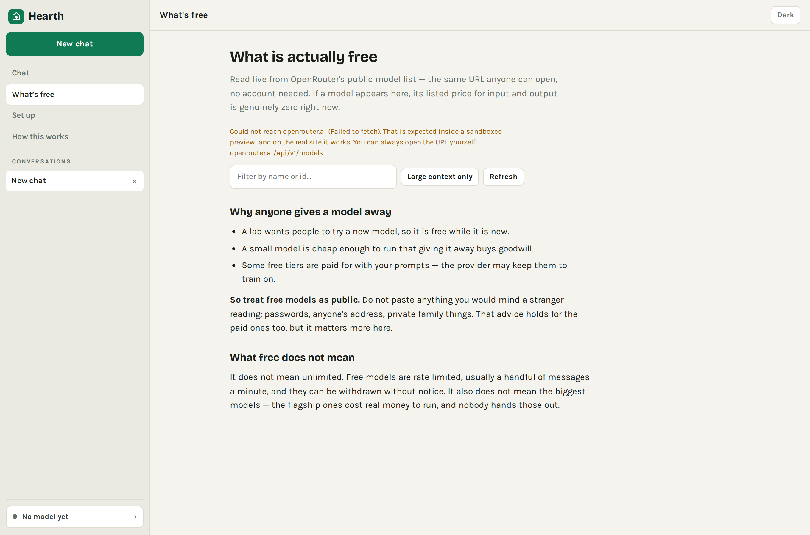

# Hearth

**Free AI, honestly.** Either run a model on your own computer, or use one that is
genuinely free — with a live, checkable list of which those are.

There is no server here. No account, no logging, no way for this site to see
anything you type.



---

## Why this exists

Search "free GPT" and you will find dozens of sites promising the newest paid
model at no cost. They cannot be doing what they say. The flagship models run on
racks of expensive machines owned by the company that built them, and every
message costs real money in compute. There is no trick around that.

So a site offering one free is doing one of three things:

1. **Spending stolen API keys.** Someone's leaked credentials are paying. That is
   theft, and knowingly using it drags you in.
2. **Serving something cheaper and lying about it.** You type to what you believe
   is a famous model; you get a small open one with a new name painted on. The
   invented version number is usually the tell — "GPT-5.6 Luna" is not a product,
   it is set dressing.
3. **Selling you.** Ads, a card number for a "free trial", your prompts, or a
   download with malware in it.

Hearth does the honest version of the same idea.

## The three real routes

| Route | Cost | Privacy | Catch |
|---|---|---|---|
| **Local model** — downloaded once, runs on your GPU | £0 forever | Nothing leaves the machine | Needs WebGPU; a few hundred MB first run; smaller models are less capable |
| **A genuinely free hosted model** — your own free key | £0 | Goes to that provider | Rate limited; some free tiers train on your prompts |
| **The official free apps** — ChatGPT, Gemini, Claude | £0 | Goes to that company | Message caps; not what this site is for, and that's fine |

The **What's free** tab reads OpenRouter's public model list live — the same URL
anyone can open without an account — and shows which models are priced at zero
right now. Models without a `:free` suffix are flagged, because a zero-priced
preview is usually being paid for with your prompts.

## Running it

Static files, no build step:

```sh
npx http-server -p 8082     # or: python3 -m http.server 8082
```

Open <http://localhost:8082>. A real origin matters — service workers and WebGPU
do not work from `file://`.

## How it fits together

| Path | What it is |
|---|---|
| `index.html` | Shell: sidebar, chat surface, and the three panels |
| `js/core.js` | DOM kit, local storage, and **sanitised** markdown |
| `js/engines.js` | The two engines — OpenRouter (streaming SSE) and WebLLM (local) |
| `js/models.js` | The live free-model directory, cached 6 hours |
| `js/ui.js` | Conversations, sending, Set up, How this works |
| `vendor/` | marked + DOMPurify, vendored so the page itself phones nobody |

**Model output is untrusted input.** It is rendered as markdown then run through
DOMPurify with an explicit tag allowlist, and links get
`rel="noopener noreferrer nofollow"`. A model can be talked into emitting a
`<script>` or a `javascript:` URL, and "it came from the AI" is not a reason to
hand it your page. There are tests for this — see below.

**Your key never touches a server of ours**, because there isn't one. It is held
in `localStorage` and sent to `openrouter.ai` and nowhere else. The chat export
deliberately strips it, so a file you share cannot leak it.

## What was and was not tested

Verified in a real browser:

- All five XSS payloads blocked, including one injected into the live DOM
- The SSE streaming parser, including a frame deliberately split across two
  network chunks
- Every provider error code (401/402/404/429/5xx) producing a human message
- The live model fetch: 24 free of 444 models, correctly tagged
- Conversation persistence across reload, markdown rendering, mobile layout

**Not tested:** actual inference. The build container has no GPU, so WebLLM could
not run, and there was no API key to spend. Those code paths follow the documented
APIs and handle their failure cases, but the first real answer is still unproven.
Try it before showing anyone.

## Licence

MIT — see [../LICENSE](../LICENSE).
