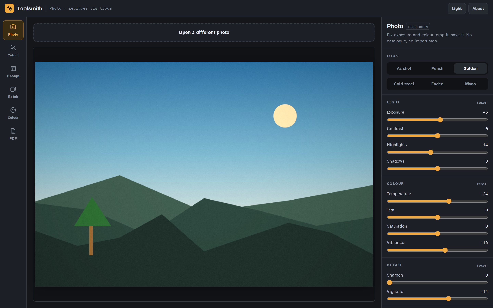

# Toolsmith

**Six creative tools in one browser tab. Pay once, not every month.**

| Tool | Instead of | What it does |
|---|---|---|
| **Photo** | Lightroom | Exposure, contrast, highlights/shadows, temperature, vibrance, sharpen, vignette, crop, six one-click looks, live histogram |
| **Cutout** | Photoshop | Click a background away and save a transparent PNG |
| **Design** | Illustrator / InDesign | Artboards with text, shapes and photos; export PNG, 2× PNG or real SVG |
| **Batch** | Bridge | Resize, convert and compress a pile of images at once, out as a zip |
| **Colour** | Adobe Color | Pull a palette out of any photo, build harmonies, check contrast passes WCAG |
| **PDF** | Acrobat | Merge, reorder, rotate, delete pages; bind images into one PDF |



---

## Why this exists

Adobe costs about £20 a month, forever, and most people use a fraction of it.
Toolsmith does the jobs people actually do most days, opens in about a second,
needs no install and no account, and asks for one payment instead of rent.

**It is not a Photoshop clone and does not pretend to be.** No layer masks, no
CMYK, no print colour management, no RAW developing. Cutout reads colour, not
meaning — flat backgrounds come out clean, hair against a forest will not. If
you need those things, the big apps are still the right tool. Everything here
is built to be honest about that up front rather than halfway through your
homework.

## Your files never leave your device

There is no server to upload to. Every pixel is processed by your own browser.
Fonts are self-hosted and the libraries are vendored, so after the first load
Toolsmith makes **no network requests at all** — which is also why it keeps
working with the wifi off, and why it is fine on a school laptop.

## Running it

Static files, no build step:

```sh
npx http-server -p 8081     # or: python3 -m http.server 8081
```

Open <http://localhost:8081>. Use a server, not `file://` — service workers and
the offline cache need a real origin.

## How it fits together

| Path | What it is |
|---|---|
| `index.html` | The shell — a topbar, a tool rail, a stage and an inspector |
| `css/app.css` | All the styling, including the light theme |
| `js/core.js` | Shared UI kit (sliders, segments, dropzones), file saving, the sample image |
| `js/license.js` | Pro gating and Gumroad key checking — see [SELLING-IT.md](SELLING-IT.md) |
| `js/photo.js` … `js/pdfkit.js` | One file per tool, each self-registering |
| `js/boot.js` | Builds the rail, wires the chrome, opens a tool |
| `vendor/` | JSZip, pdf-lib and pdf.js, loaded only when a tool needs them |

Every tool registers itself with `TS.register({id, name, swaps, blurb, icon, mount})`.
`mount(stage, inspector)` builds its own DOM and returns a teardown function.
Adding a seventh tool means one new file and one `<script>` tag.

**Design decisions worth knowing:**

- **Dark by default, on purpose.** Colour work needs a neutral ground or the
  interface skews what you think you are seeing. The light theme is a full
  re-spec, not an inversion.
- **Photo previews are capped at 1400px** so dragging a slider stays instant.
  Export re-runs the identical pipeline at full resolution.
- **Cutout records clicks, not pixels.** Each removal is stored as a normalised
  operation, so the same clicks replay exactly at preview size and at export
  size, and undo is just "replay one fewer".
- **Design keeps one ordered array of objects.** Hit-testing, z-order, PNG
  export and SVG export all read from that list, so they cannot disagree about
  what the design looks like.
- **Colour over-splits then spreads out.** Plain median cut spends every bucket
  on a big smooth sky and returns six shades of the same blue. Toolsmith cuts
  finer than needed, then picks a spread-out subset by farthest-point selection.

## Money

The paywall ships **switched off**. See [SELLING-IT.md](SELLING-IT.md) for what
a grown-up has to do to turn it on, and what it realistically earns.

## Licence

MIT — see [../LICENSE](../LICENSE).
